This work is built on [Ultra-Water](https://github.com/Humpalumps/Ultra-Water) by Humpalumps. Helio's water shaders are ports of his, and the approach in this post follows his closely. Thank you for building it and for sharing it.

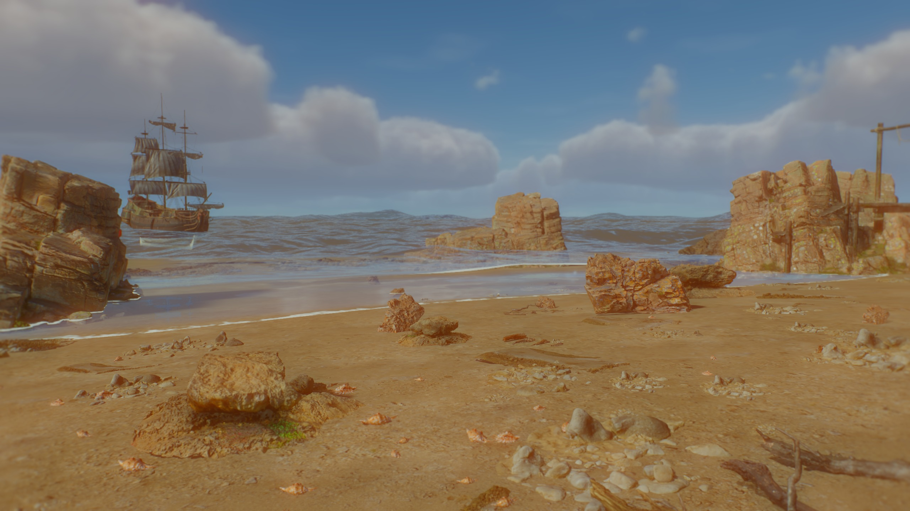

## Introduction: One Plane Is Never Enough

A sea looks simple until something stands in it. A rock needs foam around its base and a clear line where the water stops. A hull needs to sit in the surface, with the lower planks green and the waterline sharp. The same swell that lifts the ship has to flatten as it climbs the beach, steepen, lean over and break. Below the surface the sun turns into moving nets of light on the sand. Above it, the sky has to be on the water in the right amounts at every angle.

Each of those is a different problem. In Helio they share one source of truth, a heightfield with real wave physics behind it, and every system that touches the sea reads from that same field. The reflection, the refraction, the foam, the caustics, the shoreline and the swell that hits it all agree because they are the same numbers.

This post goes through that machinery in order. It starts with the spectrum that decides how tall a wave is, moves through the FFT that turns a spectrum into a surface, follows the surface to the shore, then to the shader that colours it, then under it. The last third covers the pieces around the water: the sky it reflects, the temporal resolve that cleans the image up, and the lens the stills were shot through. The scene in the pictures is a cove built from CC0 scans, and all of the frames are 2560 by 1440 renders from the engine, with no compositing.

Time of day changes more than colour. Morning, noon and night use the same ocean and the same geometry.

:::gallery
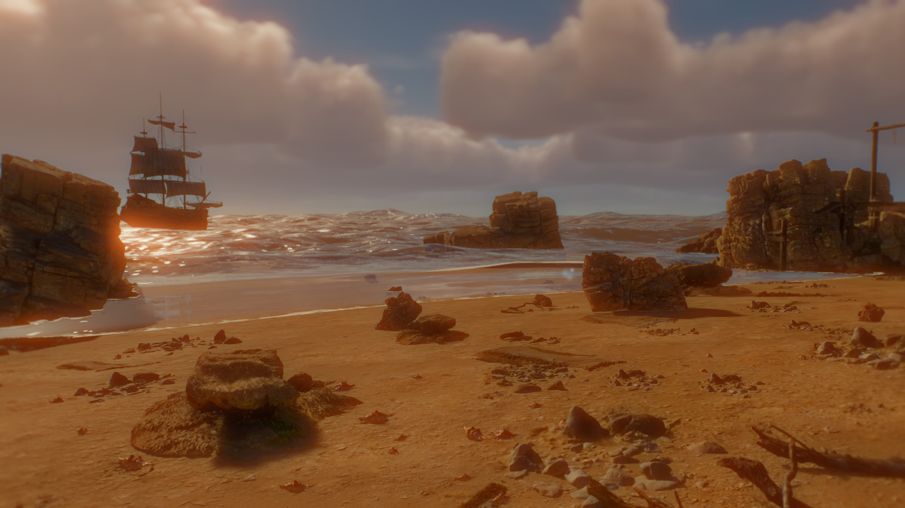

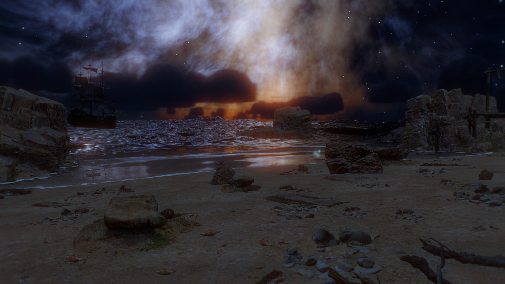
:::

## 1. The Shape of the Pipeline

The water is a plugin with five stages that run every frame.

1. A spectrum is evolved in time and inverse transformed on the GPU into displacement, slope and a fold measure for four patches of different size.
2. A polar mesh centred on the camera is displaced by those fields, with shoreline damping applied from a baked map.
3. The surface fragment shader reflects, refracts, absorbs and scatters, and lays foam on top.
4. Separate passes produce caustics on the sea floor, light shafts and fog when the camera is underwater, and spray at the shore.
5. A small pass tells the temporal resolve where the water is.

Nothing in that list is a texture someone painted. The inputs are a wind speed, a fetch, a depth map and a sun direction. Everything else is derived.

## 2. A Spectrum Decides How Big Waves Are

Oceanographers describe a sea state by how much wave energy sits at each frequency. That description is a spectrum, and the one Helio uses is JONSWAP, fitted to measurements in the North Sea in 1973. For angular frequency $\omega$ the energy density is

$$
S(\omega)=\alpha\,g^{2}\,\omega^{-5}\exp\!\left[-\frac{5}{4}\left(\frac{\omega_p}{\omega}\right)^{4}\right]\gamma^{\,r},\qquad
r=\exp\!\left[-\frac{(\omega-\omega_p)^2}{2\sigma^2\omega_p^2}\right]
$$

Here $\omega_p$ is the peak frequency, $\gamma=3.3$ sharpens the peak, and $\sigma$ is 0.07 below the peak and 0.09 above. The first part is the Pierson-Moskowitz shape: a steep rise to the peak and an $\omega^{-5}$ tail. The $\gamma^r$ factor is what makes a young sea peaky instead of broad.

The two constants come from the wind speed $U$ and the fetch $F$, the distance over which the wind has pushed on the water:

$$
\alpha=0.076\left(\frac{gF}{U^{2}}\right)^{-0.22},\qquad
\omega_p=22\left(\frac{UF}{g^{2}}\right)^{-0.33}
$$

With the reference defaults of 9 m/s and 120 km the first gives $\alpha\approx0.0092$ and the second $\omega_p\approx1.01$ rad/s, a peak period near 6 seconds and a wavelength of about 60 m. A second JONSWAP term carries distant swell, defaulting to 7 m/s over 900 km. It comes out near 0.57 rad/s, an 11 second period and a wavelength close to 190 m, travelling in a direction 35 degrees away from the local wind. A sea that has two trains crossing looks like a real sea.

Frequency is not enough. Waves spread in direction, and the spreading depends on how far the frequency is from the peak. The directional factor mixes a plain $\cos^2$ lobe with a narrower $\cos^{2s}$ one:

$$
D(\theta,\omega)=\mathrm{mix}\!\left(\tfrac{2}{\pi}\cos^{2}(\theta-\theta_w),\;N(s)\cos^{2s}\tfrac{\theta-\theta_w}{2},\;b\right),
\qquad
s=\begin{cases}9.77\,x^{-2.5}&x>1\\6.97\,x^{5}&x\le1\end{cases}+16\tanh(x)\,m^{2}
$$

with $x=\omega/\omega_p$, $b$ the spread blend (0.85 by default), and $m$ a swell weight. The exponents follow the Donelan-Banner form: low frequencies are tightly beamed along the wind, high frequencies wander. $N(s)$ is a polynomial that normalises the lobe so energy is conserved.

Waves also have to obey a dispersion relation. For gravity waves on deep water $\omega^{2}=gk$. Helio keeps the surface tension term, which matters for ripples:

$$
\omega(k)=\sqrt{gk+\frac{\tau}{\rho}k^{3}},\qquad \frac{\tau}{\rho}=7.4\times10^{-5}\ \mathrm{m^{3}/s^{2}}
$$

Long waves are faster than short ones, which is why a distant storm sends swell ahead of its own chop and why the sea never looks like one frozen pattern.

### 2.1 From density to amplitudes

A spectrum gives energy per frequency. The FFT wants a complex amplitude per wave vector $\mathbf{k}$ on a square grid. The conversion uses the Jacobian between the two, $d\omega/dk=(g+3\tfrac{\tau}{\rho}k^2)/(2\omega)$, and the grid spacing $\Delta k=2\pi/L$ for a patch of side $L$:

$$
\tilde h_0(\mathbf{k})=\xi\,\sqrt{\frac{2\,S(\omega)\,D(\theta,\omega)\,\tfrac{d\omega}{dk}\,\Delta k^{2}}{|\mathbf{k}|}}\;e^{-f^{2}|\mathbf{k}|^{2}}
$$

$\xi$ is a complex Gaussian pair generated per texel by a PCG hash and a Box-Muller transform, so a given seed always produces the same sea. The last factor is a fade $f$ (0.04 m for the gravity patches, 0.08 m for the capillary one) that removes energy a few texels before the grid's limit, where the FFT would alias.

## 3. Four Patches, Six Texels per Wavelength

A single 256 by 256 grid cannot hold a swell 190 m long and a ripple 2 cm long. Helio uses four patches whose sides span two orders of magnitude, and each one owns a band of wave numbers.

| Patch | Side | Texel | Owns wavelengths | Drives |
|---|---|---|---|---|
| 0 | 600 m | 2.3 m | longer than 14.2 m | swell, the big shape |
| 1 | 85 m | 33 cm | 2.0 m to 14.2 m | wind waves |
| 2 | 12 m | 4.7 cm | 0.35 m to 2.0 m | chop |
| 3 | 2.1 m | 8.2 mm | shorter than 0.35 m | slope and roughness only |

The cutoff between patches $i$ and $i+1$ sits at $k_c=6\cdot2\pi/L_{i+1}$. That is the wavelength at which the next patch has six texels across it, which is also the shortest wave the current patch can hold with any shape. Each patch hands everything shorter to its neighbour, so no band is represented twice and none falls between.

The three larger patches move vertices. The fourth does not, because a wavelength of a few centimetres cannot be drawn with geometry. It feeds the normal and the roughness instead.

### 3.1 Time and the loop

At time $t$ every amplitude rotates in phase, and a real surface needs the conjugate wave travelling the other way:

$$
\tilde h(\mathbf{k},t)=\tilde h_0(\mathbf{k})\,e^{i\omega t}+\overline{\tilde h_0(-\mathbf{k})}\,e^{-i\omega t}
$$

The frequency is quantised to an integer multiple of $2\pi/300$ before the phase is computed. Every wave then completes a whole number of cycles in 300 seconds, so the field tiles seamlessly in time as well as in space, and the phase is reduced before $\sin$ and $\cos$ so a long session keeps its precision in the fast capillary band.

From $\tilde h$ the evolve shader forms everything the surface needs in one pass. Horizontal displacement is $\mathbf{D}=-i(\mathbf{k}/|\mathbf{k}|)\tilde h$, slope is $\nabla h=i\mathbf{k}\tilde h$, and the second derivatives of displacement are $-k_ak_b\tilde h/|\mathbf{k}|$. Two real fields are packed into the real and imaginary parts of one complex field, so a single inverse transform returns two results. The transform is a Stockham FFT of eight stages over one atlas that holds all four patches, so the four patches share a single sequence of passes.

### 3.2 Choppiness and the fold measure

Plain height displacement gives round hills. Real crests are sharper than their troughs because water also moves sideways, toward the crest. Adding horizontal displacement scaled by a choppiness $\lambda$ sharpens the crests:

$$
\mathbf{x}' = \mathbf{x}+\lambda\,\mathbf{D}(\mathbf{x},t)
$$

When $\lambda$ is large enough the mapping folds over itself, and where it folds the wave is breaking. The fold is measured by the Jacobian of the map:

$$
J=(1+\lambda D_{xx})(1+\lambda D_{zz})-(\lambda D_{xz})^{2}
$$

$J=1$ is flat water, $J<1$ is compression, and $J\le0$ is a surface that has crossed itself. The assemble pass writes $J$ into the fourth channel of the displacement texture and a foam history alongside it. Slopes are divided by the horizontal stretch $\max(1+\lambda D_{xx},\,1+\lambda D_{zz},\,0.2)$, because a normal measured on the undisplaced grid is wrong on the stretched one.

## 4. The Mesh

The surface is a polar grid of 384 angular columns centred on the camera. Rings are dense near the eye and sparse toward the horizon, and the inner rings expand as the camera rises. Above 60 m every second column collapses onto its neighbour in the vertex shader, which halves the angular resolution without changing the allocation, and degenerate triangles disappear.

Each vertex samples the three geometric patches with a mip level chosen from its cell size, $\mathrm{lod}=\max(\log_2(c\cdot256/L)+1,\,0)$, so a vertex covering several wave texels reads a filtered value instead of aliasing. The displacement textures carry a complete mip chain built after each transform.

Because vertices move horizontally, the height at a world position is not the height sampled there. To find it, which is what a floating body or a ray query needs, the shader inverts the map with four fixed point steps: start with $\mathbf{p}=\mathbf{x}$, replace $\mathbf{p}\leftarrow\mathbf{x}-\lambda\mathbf{D}(\mathbf{p})$ four times, then read the height at $\mathbf{p}$. That is the same function the surface, the fog boundary and the Snell window use, which is why they agree.

:::compare
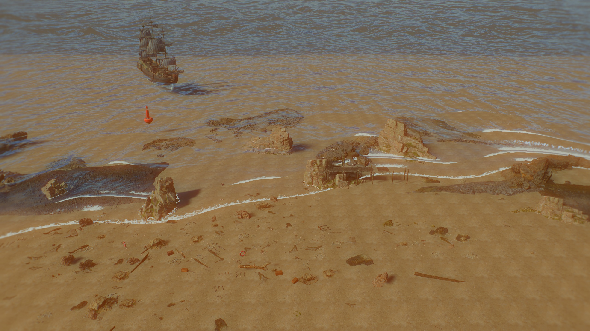
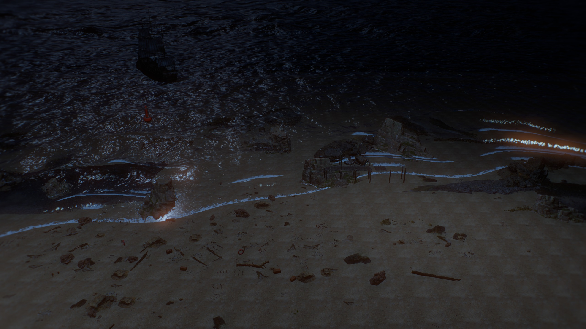
:::

## 5. The Shore

Open water follows the spectrum. Near land the sea has to change, and it changes in ways that depend on depth. Waves slow down, shorten, grow taller, steepen, and break. None of that is in a deep water spectrum.

The shoreline is baked from terrain data. A terrain provider answers one question, the elevation at a point, and Helio samples it on a 512 by 512 grid across the map, 1 m per texel here. Water is wherever the rest plane sits above terrain. The zero contour of that sign change is the coast, and the baker computes a signed distance to it.

### 5.1 Travel time

A shallow water wave travels at $c=\sqrt{gd}$ where $d$ is depth. A crest that is a given distance from the coast arrives at a time set by the integral of $1/c$ along its path. That integral satisfies the eikonal equation

$$
|\nabla T(\mathbf{x})|=\frac{1}{c(\mathbf{x})}=\frac{1}{\sqrt{g\,d(\mathbf{x})}}
$$

with $T=0$ on the coast. The map solves it by fast sweeping: four diagonal sweeps of the grid, each updating a cell from its neighbours with the discrete form

$$
\left(\frac{T-a}{\Delta x}\right)^{2}+\left(\frac{T-b}{\Delta z}\right)^{2}=\frac{1}{c^{2}}
$$

where $a$ and $b$ are the smaller neighbour values along each axis. The solver stops when a full round of four sweeps changes nothing, and runs at most twelve rounds. The result is a field of arrival times whose gradient points along the direction waves travel, and whose level sets are the crests.

### 5.2 Shore trains

Two trains run on top of the spectrum near the coast, with wavelengths of 30 m and 18.3 m. For a train with $\omega=\sqrt{2\pi g/\lambda}$ the phase at a point is

$$
\phi=\omega\,(T(\mathbf{x})+t)+\phi_{\text{noise}}
$$

so crests follow the level sets of $T$ and bend to wrap the headlands exactly as real swell refracts around a point. The local wave number is $k=\omega/c$, shortening the wave as depth falls. Amplitude follows Green's law for shoaling, $a\propto d^{-1/4}$, capped at $0.42\,d+0.14$ m so a wave in a few centimetres of water cannot be a metre tall.

The ratio $a/d$ decides when a wave breaks. Once it passes a threshold between roughly 0.12 and 0.3, modulated by noise so neighbouring crests do not break in step, the train leans forward with a pitch term and its foam source turns on. Compression terms keep the crest from folding over itself.

### 5.3 Waves stop at the land

The deep water spectrum does not know where the beach is, so the shader applies the shore map as a damping on every patch. Patch 0 is multiplied by $\mathrm{smoothstep}(2,26,d)$ and the other three by $\mathrm{smoothstep}(0,2,d)\cdot\mathrm{mix}(0.55,1,\mathrm{smoothstep}(0,10,d))$. The shore trains fade in over the first 0.6 m of depth. Over dry ground, where $d\le0$, every term is zero and the surface is flat at the rest height.

The consequence is that a crest never rides up the beach as a sheet. Water is wavy offshore, loses its swell in the last two metres, and reaches the sand as a flat film with foam on the contact line.

:::gallery
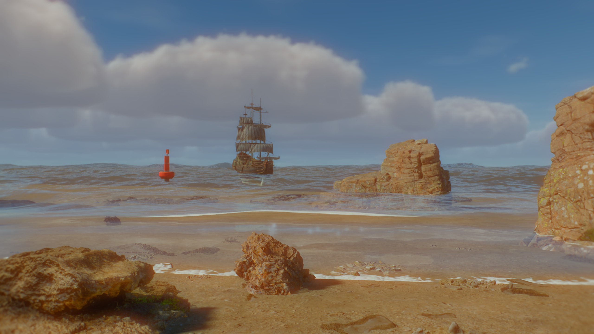
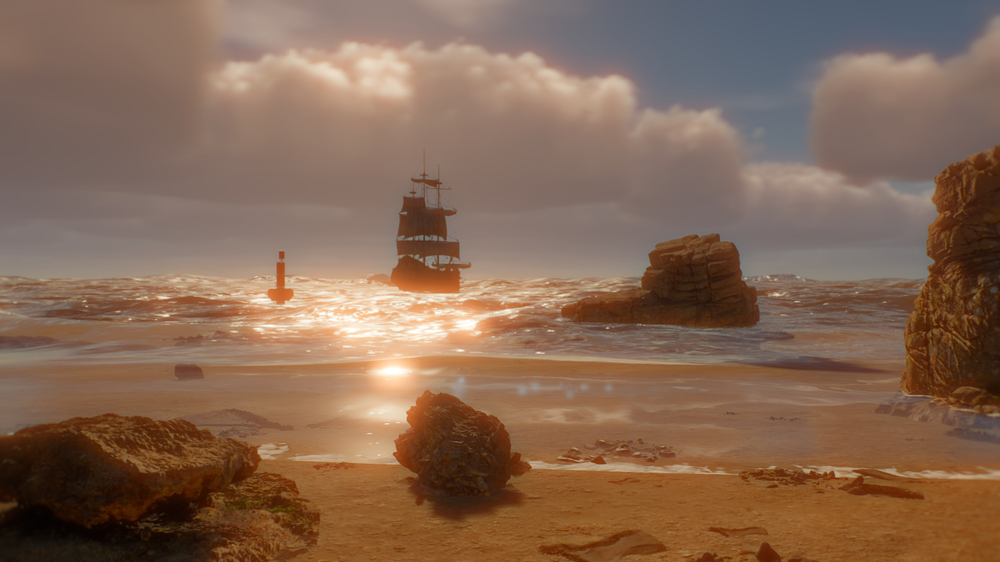
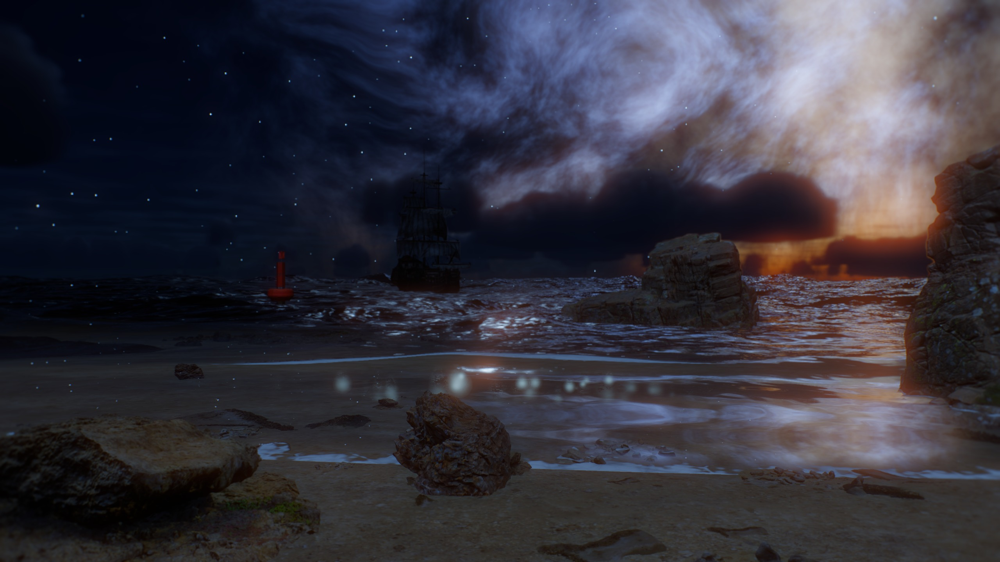
:::

## 6. Shading the Surface

Given a displaced point and a normal, the fragment shader answers one question: what colour comes to the eye? The answer is a sum of reflected light, light that has gone through the water and back, and foam.

### 6.1 Fresnel and roughness

Water reflects 2% of light at normal incidence and nearly everything near grazing. Schlick's form with $F_0=0.02$ is

$$
F=F_0+(F_{90}-F_0)\,(1-\mathbf{n}\cdot\mathbf{v})^{5}
$$

Helio does not leave $F_{90}$ at 1. A far patch of sea contains many unresolved waves, and a pure Fresnel curve would turn the horizon white. The shader lowers $F_{90}$ by the surface roughness, $F_{90}=\max(1-0.7\sqrt{\alpha},\,F_0)$, which keeps the horizon the colour of water.

The roughness $\alpha$ comes from the slope variance the surface carries. Each patch stores the mean slope and the mean squared slope in its mip chain, and subtracting the square of the mean from the mean of the square leaves the variance of slopes inside a footprint, which is what a rough microfacet distribution describes:

$$
\alpha^{2}=\alpha_0^{2}+\sum_{i}\left(\overline{s_i^{2}}-\overline{s_i}^{\,2}\right)+\sigma_{\text{unres}}^{2}+\sigma_{\text{geo}}^{2}
$$

where $\alpha_0=0.02$, the sum runs over the four patches, $\sigma_{\text{unres}}$ is a Cox-Munk estimate of the slope variance in waves shorter than the finest patch, and $\sigma_{\text{geo}}$ comes from screen-space derivatives of the normal. The same trick is behind specular anti-aliasing in any engine: when many waves share a pixel, the surface should look rough, not shimmer.

### 6.2 The sun on the water

The sun's reflection uses a GGX lobe with Smith's height-correlated visibility:

$$
D=\frac{\alpha^{2}}{\pi\left[(\mathbf{n}\cdot\mathbf{h})^{2}(\alpha^{2}-1)+1\right]^{2}},\qquad
V=\frac{0.5}{(\mathbf{n}\cdot\mathbf{l})\sqrt{(\mathbf{n}\cdot\mathbf{v})^{2}(1-\alpha^{2})+\alpha^{2}}+(\mathbf{n}\cdot\mathbf{v})\sqrt{(\mathbf{n}\cdot\mathbf{l})^{2}(1-\alpha^{2})+\alpha^{2}}}
$$

A smooth lobe is the correct average and the wrong picture. Far away the pixel footprint covers a few thousand facets and only some of them point at the sun, so the real sea sparkles. Helio estimates how many facets mirror the sun in a footprint. The expected count per unit area is

$$
\lambda=\rho_f\,D\,(\mathbf{n}\cdot\mathbf{h})\,\frac{6.8\times10^{-5}}{4\max(\mathbf{v}\cdot\mathbf{h},0.05)}
$$

with a facet density $\rho_f=2\times10^{4}$. A Poisson draw with that mean gives an integer count for each cell of a world-space grid, and the specular is multiplied by $\min(\text{count}/\lambda,\,300)$ so the average stays the GGX value while individual cells flash. Two adjacent grid levels and two time steps are cross-faded to hide the cell boundaries, and the effect fades in between 4 m and 30 m from the camera.

### 6.3 Seeing through

Light that passes through the surface is bent. For a ray entering water with refractive index $n=1.333$ Snell's law gives $\sin\theta_t=\sin\theta_i/n$. Helio does not trace this. It offsets the screen lookup by an amount that depends on how tilted the surface is and how far the light travels beneath it:

$$
\Delta=\mathrm{clamp}\!\left(\mathbf{n}_{xy}\,\ell\,\left(1-\tfrac{1}{n}\right)k_r,\ \pm2\ \mathrm{m}\right)
$$

where $\ell$ is the path length through water along the view ray, taken from the depth buffer, and $k_r$ is a refraction strength. The offset is converted to pixels with the projection, so distortion does not grow as the camera backs away. Shallow water barely bends anything and deep water bends a lot, which a fixed pixel offset cannot express.

An offset can land on something in front of the water, such as a rock that breaks the surface or a hull. That object must not be dragged into the refraction. The shader reads the depth at the offset position and blends the offset out with $\mathrm{smoothstep}(z_s-0.3,\,z_s+0.3,\,z_{\text{refr}})$, so objects stay in front without a hard outline.

### 6.4 What the water takes away

Light travelling through water is absorbed, and red goes first. For a path length $\ell$ and a per-channel extinction $\boldsymbol{\sigma}$, Beer-Lambert gives the transmitted fraction

$$
\mathbf{T}=e^{-\boldsymbol{\sigma}\,\ell}
$$

The default coastal values, $\sigma=(0.26,0.08,0.04)$ per metre, take red down to 5% in about 11 m and blue in more than 70 m. A sand bar in half a metre of water is nearly unchanged and a rock a few metres down has lost its warmth. The colour a viewer sees is the refracted scene scaled by $\mathbf{T}$, plus light scattered toward the eye by the water itself:

$$
\mathbf{C}_{\text{water}}=\mathbf{C}_{\text{refr}}\,\mathbf{T}+\left(\mathbf{C}_{\text{in}}+\mathbf{C}_{\text{sss}}\right)(1-\mathbf{T})
$$

The in-scattered term is the water colour times the sky ambient and the sun, weighted by a Henyey-Greenstein phase function with $g=0.35$ so water glows when you look toward the sun and darkens when you look away from it. The subsurface term is a lift on crests lit from behind, $1.6\,h_c\,(\mathbf{l}\cdot-\mathbf{v})^{4}(0.5-0.5\,\mathbf{n}\cdot\mathbf{l})^{3}$ with $h_c$ the crest height above rest. It is why a wave backlit by a low sun shows green in its thin top.

The final colour mixes the water-leaving light with the reflected sky by the Fresnel term and adds the sun glints. Where the water meets geometry the reflection fades with the path length, so a contact line does not read as a hard analytic edge.

### 6.5 What the sea reflects

Reflections have two sources. A half resolution planar capture of the opaque scene, mirrored across the water plane with an oblique clip plane, supplies the near field. It is sampled with a mip level that grows with the slope, so a rough sea reflects a soft picture and a calm one a sharp picture. Screen-space marching through a min-reduced depth pyramid adds hits the capture cannot see, and the shader blends the two by the march's own confidence instead of switching between them. Where neither has anything to say, the answer is the sky.

:::compare
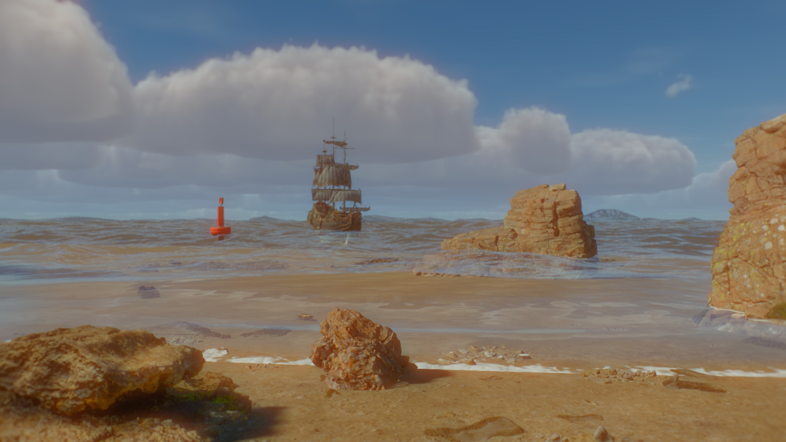

:::

## 7. Under the Surface

A camera below the surface sees the world through a different set of rules. Looking up, rays leave the water into air, and the critical angle is

$$
\theta_c=\arcsin\frac{1}{n}=\arcsin\frac{1}{1.333}\approx48.6^{\circ}
$$

Inside that cone the view passes through the surface and shows the sky, squashed into a disc, the Snell window. Outside it the rays cannot escape and the underside of the surface acts as a mirror onto the submerged scene. The shader implements this with `refract`: a zero length result is total internal reflection, and the surface becomes a mirror for that pixel. The disc's edge wobbles with the waves because the normal comes from the same displaced field.

Fog and light shafts fill the volume. Fog uses the same Beer-Lambert extinction as the surface, evaluated along the view ray down to the floor, so colour shifts from warm to blue with distance. Shafts march the view ray at half resolution and add the sunlight that reached each step, modulated by the same caustic field that lights the sea floor, so the beams and the net of light on the sand come from one pattern. A depth-aware upsample brings them back to full resolution.

## 8. Caustics

The moving net of light on the sea floor is the sun focused by the waves. A concave patch of surface acts as a lens and concentrates light, a convex one spreads it. Helio computes this by tracing the sun through the surface geometry and measuring how areas change.

Take a regular grid on the surface, with slope $\mathbf{s}$ read from the 12 m patch with cubic B-spline filtering. The surface normal is $\mathbf{n}=(-s_x,1,-s_z)/\lVert\cdot\rVert$. The sun direction refracts through it with ratio $\eta=1/n$, and the refracted ray lands on a plane at depth $d$ below the surface displaced from where a flat surface would land it:

$$
\Delta\mathbf{x}=\left(\frac{\mathbf{r}_{xz}}{-r_y}-\frac{\mathbf{r}^{0}_{xz}}{-r^{0}_y}\right)\frac{d}{L}
$$

where $\mathbf{r}$ is the refracted direction through the tilted normal, $\mathbf{r}^0$ the refracted direction through a flat surface, and $L=12$ m is the patch size. Each grid triangle is drawn at its landing position. The brightness of the light at a point on the floor is the ratio of the area a triangle had on the surface to the area it has when it lands:

$$
I=\frac{A_{\text{surface}}}{A_{\text{floor}}}
$$

The fragment shader gets this from screen derivatives of the source position, $I=|\partial_x\mathbf{p}\times\partial_y\mathbf{p}|$, capped at 16 so a point focus does not blow out. Where a triangle folds, thin slivers of high intensity form the bright lines. Four times multisampling resolves those slivers by coverage instead of aliasing them.

Three depth slices are drawn, near, middle and deep, each into its own texture with a mip chain. A receiver picks a slice by its depth below the surface and attenuates with $e^{-0.12\,d}$. The same textures feed the surface, any deferred receiver under the sea and the half resolution shafts, so every way of looking at the caustics shows the same pattern.

## 9. Foam and Spray

Foam is where the wave field says the water has turned over. Three things contribute.

The first is the fold measure from section 3.2. A texel remembers how low $J$ has been recently, and the history decays at a rate that depends on how folded the surface still is:

$$
T_{n}=\min\!\left(J,\ T_{n-1}+\frac{\Delta t\,r}{\max(J,0.5)}\right)
$$

Foam appears the instant $J$ drops and fades on a time scale set by the recovery rate $r$, so a breaking crest leaves a trail that thins behind it. The second source is the shore train's break term. The third is contact: a film 0.35 m wide wherever the depth to the scene behind the surface falls near zero, which is what draws foam around rocks and along the waterline.

The coverage from those sources is shaped by a tileable cellular material baked once, with mip maps. Three octaves of Voronoi at 7, 17 and 41 cells give the lace, using the gap between the nearest and second nearest feature point, $\sqrt{\mathrm{clamp}(2.2\,(F_2-F_1),0,1)}$, so cell borders become thin filaments. Strong coverage fills the filaments in and weak coverage leaves only the cell edges.

Spray at the shore uses the same shore map. Emitters are packed from shallow water near the coast and the vertex shader launches camera-facing droplets using the same travel-time waves and breaking envelope as the surface, so spray rises where a wave breaks and not where it did not.

## 10. Sky and Light

The sea reflects whatever is above it, so the sky is part of the water.

Helio's atmosphere computes single and multiple scattering from the sun into a sky-view table, adds ray-marched volumetric clouds, and composites an optional equirectangular panorama underneath. Morning and noon use the physical sky with different sun elevations, a warm colour, and different cloud cover. Morning also has a pure-sky panorama from Poly Haven, which carries the horizon glow a procedural atmosphere only approximates.

Night turns the panorama layer to a galaxy and nebula, and the procedural stars on. Nine thousand stars with a brightness distribution and a twinkle fraction sit above a panorama of the galactic core, tilted so the band of light arcs over the cove. Those layers fade by how bright the directional lights are, so the moon is kept dim, near 0.04. A dim moon cannot light a beach by itself, so a few cool lights above the scene fill the sand and rocks without brightening the sky.

The sun's direction also drives the sea. The water volume carries the sun direction and intensity, and the in-scatter, subsurface, glints and caustics all use them. Move the sun and the sea changes with it.

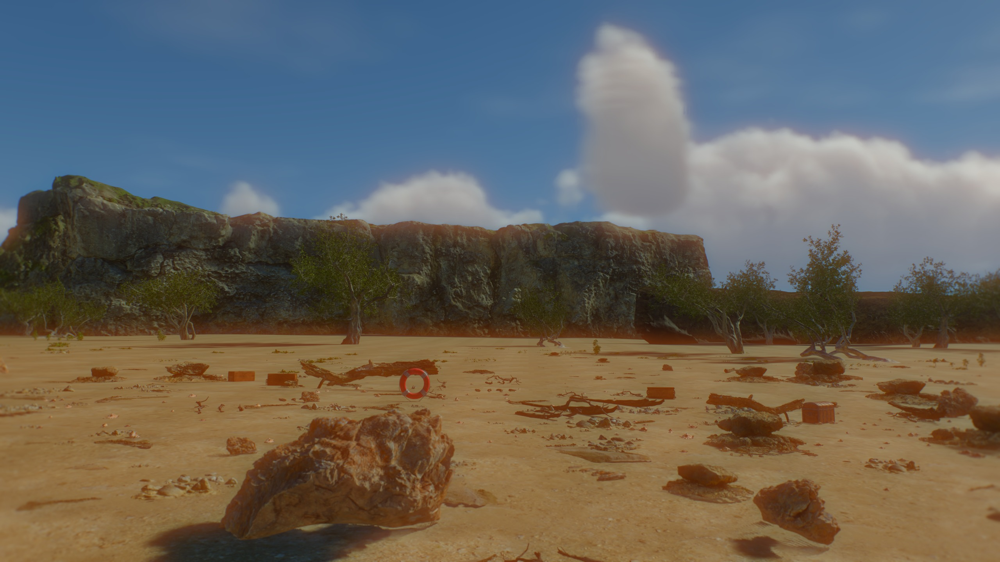

## 11. The Temporal Resolve

A frame of this scene has two kinds of content. Rocks, sand, sky and ship are stable: they have geometry, a velocity, and the same pixels from one frame to the next except for sub-pixel jitter. Water is not stable. Its shading changes every frame because the waves move, the glints flicker, and the velocity stored for a water pixel is the velocity of whatever is under it.

Helio's temporal super resolution jitters the camera by a sub-pixel offset each frame and accumulates the samples. A static scene converges to an image with many samples per pixel instead of one. Details thinner than a pixel, a rigging line on the ship, a rock edge against the sky, a pebble at the horizon, resolve to a stable picture with no stair steps.

The stills here are rendered at the output resolution of 2560 by 1440, with TSR running at native scale, from a camera that does not move. By frame 300 the resolve has several hundred jittered frames to draw on.

:::compare

:::

The resolve blends each pixel with its reprojected history using a confidence weight. The history weight shrinks as

$$
w\leftarrow w\,(1-r),\qquad r=\max(r_{\text{global}},\,c_{\text{now}},\,c_{\text{prev}})
$$

where $c$ is a per-pixel coverage that producers write into a mask. Transparent meshes already write it. Water writes it too. After the transparent phase a small pass reads the surface's own depth, which is nonzero exactly where the surface was drawn, and raises the mask to 0.8 with a max blend so it never lowers a transparent mesh's own coverage. With $r=0.8$ the earlier frames' contribution is cut to a fifth every frame. The sea settles to an image dominated by the current frame, with enough smoothing to take the edge off aliasing, and it does not smear its own waves along the velocity of the sea floor.

Everything else in the picture, which is most of the pixels, accumulates in full. That split is what lets the same frame hold a very clean sky and an animated sea.

Here is the ship, 100 m out, cropped from the two frames and enlarged. With FXAA the rigging is a scatter of dots and the spars break into pieces. With TSR the shrouds, the ropes coiled on the hull and the yardarms are continuous lines, because every frame has sampled a slightly different part of each pixel.

:::compare

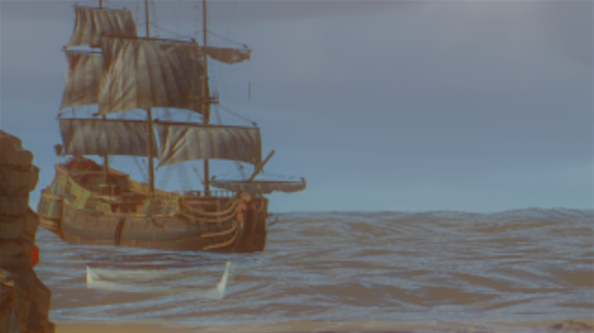
:::

## 12. The Camera

A photograph is formed by a lens, and the lens leaves marks: a little blur away from the focal plane, coloured fringes at the edges, glow around bright light, and a falloff to the corners. Helio has a lens system that models those as elements applied to the scene's linear radiance, before exposure and tone mapping. The stills use a short stack.

The blur away from focus follows the thin lens equation. For focal length $f$, f-number $N$, focus distance $s_f$, object distance $s_o$, sensor width $W_s$ and image width $W_{px}$, the circle of confusion in pixels is

$$
c_{px}=\frac{f^{2}}{N}\,\frac{|s_o-s_f|}{s_o\,(s_f-f)}\,\frac{W_{px}}{W_s}
$$

The camera is a 35 mm lens at f/5.6 on a 36 mm sensor, focused at 8 m for the hero frame, rendered at 2560 pixels. A rock 3 m away comes out with a blur of 3.3 pixels. The ship at 100 m has 1.8 and the horizon, at infinity, 1.95. The hyperfocal distance for a one pixel blur is $f^2/(N\,c)+f\approx15.6$ m. That gives a gentle depth of field. Foreground stones soften, distant detail does not, and the picture keeps the sharpness TSR just worked for.

The elements in the stack:

- natural illumination falloff, the $\cos^{4}$ law, at a low amount, 0.12
- lateral chromatic aberration, 0.0012 of magnification across wavelengths, sampled at 16 wavelengths
- a Pro-Mist diffusion filter at 0.14, which lifts the halo around highlights
- film halation at 0.35 with a radius of 0.012 of the image height, the red-orange glow around bright points
- a little corner softness, 0.0025 image heights, from the way real lenses lose resolution toward the edges

Alongside the lens, the post chain applies a filmic tone map (AgX), a gentle bloom above a threshold of 1.1, contrast and saturation nudges of 8% and 4%, and a local exposure curve with its shadow contrast set to 0.7. Exposure differs by time of day, 2.3 at noon, 3.0 in the morning and 5.0 at night, because the sky and the sea are metered differently.

:::compare
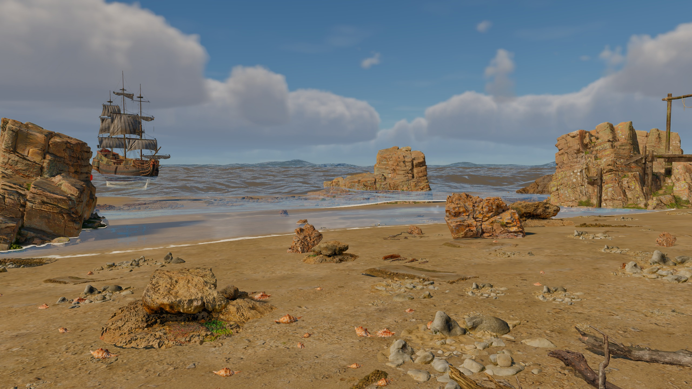

:::

## 13. The Scene

The cove is built from scans. A few come from Megascans and the rest from Poly Haven, all CC0 or free-use: sand and rock formations, sea stacks, cliffs, boulders and stones scattered in clusters, shells along the wrack line, driftwood, grass, ferns, shrubs and trees in the dunes behind the beach, a lifebuoy, barrels, crates, a pier, a sea marker and a ship. Placement is data. A cluster scatter puts small things in many places and large things in few, with a power-law size distribution, and everything sinks a few centimetres into the sand so nothing floats on the slope.

Materials keep their authored maps. Colour is sampled as sRGB and mip filtered in linear light, so distant sand does not darken. Normal maps are flagged and filtered so that their variance survives into roughness at a distance, the same trick as the water. Roughness and occlusion are treated as data. Large scans keep their 2K textures and the small props are halved to 1K, since a 4K pebble tells a viewer nothing.

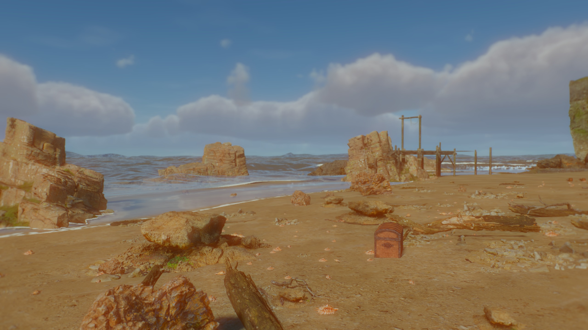

## 14. What It Does Not Do

The surface is a heightfield. A wave can steepen and lean but it cannot throw a lip over itself, and the foam at a breaker is a texture on the surface with no volume of air and spray moving inside it. Foam does not persist as simulated state. It is a function of the fold history, which is enough to leave a trail and not enough for a wake that lingers after the wave that made it has gone.

The water pass writes a reactivity mask for TSR, but it does not write motion vectors. The resolve drops history over water, which keeps it correct and costs some sharpness: a very fine glint pattern at the horizon will shimmer more than the sky above it.

Local lights reach the surface as specular highlights and foam diffuse, but their shadows and light functions are not sampled by the water. The underwater path is lit by the sun. The planar reflection captures opaque geometry only.

Bodies in the water do not float yet. The surface query and its inversion exist so a body can ride the waves, and the simulation accepts hitboxes that push the surface, but the ship in these frames is placed and does not float.

## Credits

Terrain and props: Poly Haven models and HDRIs, CC0, with a Megascans rock formation. Night sky: Deep-Space Skybox by Toolbench, CC0. The scene, the water, the sky, the lens and the post chain are Helio running in Pulsar.

Once more, thanks to Humpalumps and [Ultra-Water](https://github.com/Humpalumps/Ultra-Water). The spectrum, the cascades, the shading model and the caustics here all started in his shaders.
