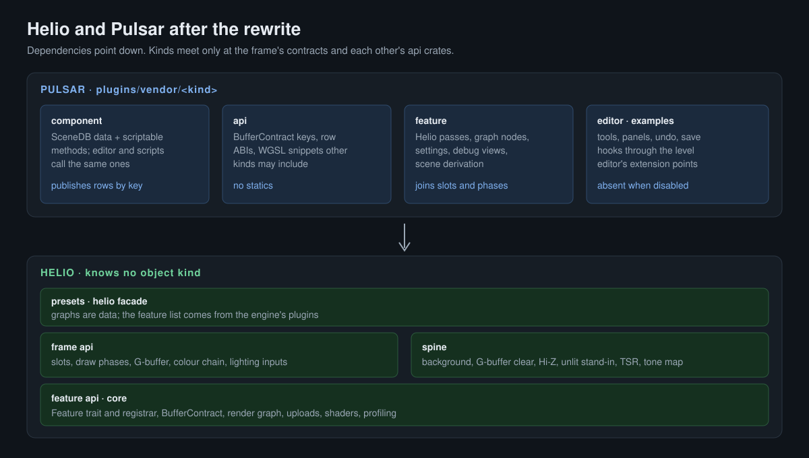

Helio used to know about everything it drew. Meshes, lights, materials, the sky, voxel terrain, water, foliage, decals, portals: each had code inside the renderer, and most of them had a SceneDB component living there too. As of this week none of that is in Helio. Every object kind is a Pulsar plugin that owns its data, its rendering, its file formats and its editor UI, and Helio is the frame those plugins draw into.

This post covers what the rewrite changed and why, in the order the pieces depend on each other. It starts with the measurements that started it, then the rules, the layers, the contracts between plugins and the renderer, the checks that keep the rules true, and the numbers afterwards.



## 1. Where the code was on October 31

The plan started from measurements, taken against both repos' main branches.

| Fact | October 31 |
|---|---|
| Helio workspace crates | 70, of which 54 were pass crates |
| Pass code | 177k lines of Rust and 47k of WGSL in one flat layer |
| SceneDB components defined in the renderer | 31 `#[derive(SceneStore)]` structs in 14 pass crates |
| Graph builder functions | 27, one per combination of features |
| `engine_backend` reaching into passes | downcasts into TSR, fog, post volumes, water and the voxel chunk pass |
| `helio-component` | 32k lines in the Helio repo that only built inside Pulsar's workspace |

One number made the case. In October, 161 of 408 voxel commits (40%) also changed crates outside the voxel code, and 36 changed four or more. A terrain change routinely touched the default graphs, the examples, `helio-component`, `helio-core` and the shadow, foliage, GI and fog passes.

The causes were structural. A pass was the only unit Helio had, but the real units were systems: GI, shadows, virtual geometry, water and voxels are each several passes plus glue plus settings plus a component. Dependency direction was not enforced, so passes imported passes for their types. Components lived in the renderer, so every culler and shadow pass imported the G-buffer pass to get the mesh component. Graphs were code. That is where the 27 builders came from.

## 2. The rules

Four rules came out of that diagnosis, and the rewrite applied them to every kind.

Every object kind is a Pulsar plugin. The plugin owns its SceneDB component, the Helio feature that renders it, its scene derivation, its file formats and its editor UI.

Component methods are the API. The editor calls the same scriptable methods a script would. No renderer setters for one kind, no mailbox messages, no reaching into a pass by type.

Helio knows no object kind. It has no API for meshes, lights, materials, voxels, water, sky, fog or any other kind. A feature's passes read only what components publish.

One owner per concept. Materials, lights, the sun, wind, water, shadows and GI each have exactly one owning plugin. Other kinds use the owner's api crate or WGSL snippet and never keep a private copy. A kind adds only its own addressing: UVs for meshes, triplanar and per-voxel ids for voxels.

## 3. The layers

Helio is now a stack where dependencies point down only.

- Core (`helio-core`): the render graph, scheduling, resources, uploads, shaders, profiling, and the `BufferContract` type.
- Feature API (`helio-feature-api`): the `Feature` trait and the registrar a feature registers its nodes, settings, debug views and contracts through.
- Frame API (`helio-frame-api`): the contracts every kind meets at. Slots, draw phases, the G-buffer layout, the scene colour chain, and lighting inputs with stand-ins.
- Spine (`helio-spine`): the few passes no kind owns. A background clear, a G-buffer clear of last resort, the Hi-Z pyramid, an unlit stand-in for when no lights plugin is installed, TSR and the tone map.
- Presets and the facade: graphs are data, built from whatever features the engine registers.

Each plugin under `plugins/vendor/<kind>/` in Pulsar has the same crates: `component`, `api`, `feature`, `editor`, and usually `examples`. A plugin depends on Helio core and on other plugins' `api` crates. It never depends on another plugin's feature or component.

## 4. Features, slots and draw phases

A feature is the unit a plugin adds to Helio. The trait is small on purpose:

```rust
pub trait Feature: Send + Sync + 'static {
    /// Stable id, used in diagnostics and by engines to name the feature.
    fn id(&self) -> &'static str;

    /// Registers what the feature contributes. Called once per registry.
    fn register(&self, registrar: &mut FeatureRegistrar<'_>);
}
```

Through the registrar a feature adds node types, preparers and finishers, the buffer contracts its passes read, settings and debug views. The renderer and the graph compiler see only what was registered.

Placement comes from the frame. A feature registers its nodes at a slot and the preset puts them there without naming the feature. There are nine slots, from `Prepare` (per-frame tables, an object kind's batches) through `Visibility`, `Geometry`, `LightingInputs`, `Lighting`, `Media`, `Resolved` and `Display` to `Output`. Drawing goes through draw phases: `ShadowCasters`, `DepthPrepass`, `GBuffer`, `Forward`, `Transparent` and `Overlay`. A phase is a place where every kind with something to draw there draws, into attachments the frame owns. Meshes, voxels and foliage all register G-buffer drawers. Decals draw after them. Billboards and light sprites draw in `Overlay`. The spine runs the phases and draws nothing itself.

Lighting reads inputs with generic names. Indirect diffuse, indirect specular, sun visibility, transmission, the sky and the light list are contracts. The lighting model never reads water, portals or reflection captures by name. A missing owner means a stand-in through the contract. Remove the lights plugin and the frame draws unlit albedo plus emissive.

## 5. Buffer contracts

The seam between a component and a feature is a buffer contract: a key plus a row layout. The consumer owns the layout, because the shader reads it. Foliage's wind is a typical one, declared in the foliage `api` crate:

```rust
#[derive(bytemuck::Pod, bytemuck::Zeroable, Clone, Copy, Debug, PartialEq)]
#[repr(C)]
pub struct FoliageWindRow {
    pub direction_speed: [f32; 4],
    pub gust: [f32; 4],
    pub time_prev_time: [f32; 2],
    pub _pad: [f32; 2],
}

/// The buffer the renderer reads [`FoliageWindRow`]s from. Engines produce it
/// (a SceneDB component stored under this key, or a scene derivation).
pub const FOLIAGE_WIND: helio_core::BufferContract<FoliageWindRow> =
    helio_core::BufferContract::new("foliage_wind");
```

The authored `WindComponent` lives in the plugin's `component` crate with its editor properties and methods. SceneDB mirrors its rows to the GPU under the contract's key, and the feature binds that key. Layout tests on both sides keep the Rust row and the WGSL struct identical. One pitfall showed up early: SceneDB accepts any `Send + Sync` value as a component, so inserting a bare row compiles fine and never reaches the GPU. Generating the component builders from the row removed that class of bug.

Helio still binds those keys through SceneDB's buffer projection. It defines no component of its own outside its test host. The test host writes contract rows by key for Helio's own examples and tests.

## 6. Checks that keep the rules true

Four checks keep the rules true. They run in CI or as tests.

The layer gate (`just arch`) checks `cargo metadata` against `architecture/layers.toml`. Its violation list only shrinks. It held 19 entries at the start of the rewrite and holds none now.

`one_owner` compares every shader's WGSL declarations, by name and by field layout, against every owner's snippets, and compares Rust string literals used as resource names against every owner's key constants. A copied struct or a hand-typed key fails the test. Its exception list is also shrink-only, and a stale exception fails too. The last copy it caught was TSR's reactive-mask key, spelled out in three places after a merge. That key now lives in the frame API.

Absent plugins are tested. A project lists its plugins in `Pulsar.toml`, and each plugin has a descriptor:

```toml
id = "pulsar.water"
name = "Water"
enabled_by_default = true
requires = []

[modules]
runtime = ["water_component"]
editor = ["water_plugin"]
```

Every registration a plugin makes carries its origin, and every registry iterates only enabled origins. A disabled plugin's kind is absent: no component classes, no feature, no editor tools, no menu entries. This one started from a bug report. With the voxel plugin "uninstalled", voxels still rendered, because the engine linked every plugin unconditionally.

Pass-list snapshots compare the full pass list of every preset across five configurations. Each phase had to reproduce the previous phase's lists, or explain every difference.

## 7. The editor became a shell

`ui_level_editor` named object kinds in dozens of files. The sculpt tool, the terrain panel and the light editor lived there. Now it names no plugin. Plugins' editor crates register tool modes, create-menu entries, World Settings sections, save hooks, editor data, undo entries, overlays and AI-assistant tool namespaces through `ui_level_editor::extend`. The kind's component crates appear in the level editor's manifest only as dev-dependencies, for tests.

The shader editor got the same treatment. It had its own graph compiler and preview shaders, and both are gone. The material graph editor is now the materials plugin's editor. It compiles through the materials plugin's one compiler and previews with the plugin's shared preview program. The asset viewer uses the same program, so the editor can no longer drift from what the engine renders.

## 8. How it landed

The rewrite ran as 18 phases, p0 to p17, each on a branch with the same name in both repos (`rewrite/p5-features`, `rewrite/p16-mesh-components`, and so on). Each phase was one PR per repo, stacked on the phase below it.

Groundwork came first: guard rails and the layer gate, buffer contracts, the feature API and the spine. Voxel moved next, as the pilot, since its coupling was the worst measured and its 43k lines of Rust and 10k of WGSL had shipped as "a pass". The leaf kinds followed (decals, particles, sprites, portals, splines, lens), then the media kinds (fog, post, water, foliage), then GI and sky, meshes, lights and materials. After those came the one-owner audit, absent plugins, the editor extension points and the mesh components. A cleanup phase closed every leftover the earlier phases had written down.

Three things were checked at every phase. The pass lists had to match. A `voxel_craft` build was A/B tested against the previous phase's binary, kept on disk so no base commit had to be rebuilt. The render acceptance suite had to pass or the failure had to be explained. At the end it passes 27 of 27. Before the cleanup phase, 6 of those failed.

Moving code surfaced real bugs, some of them old:

- The depth and normal debug views compared mode numbers 40 and 41 in the shader while Rust sent 42 and 43. The test passed only on frame noise.
- Point and spot light shadows never darkened anything. A constant depth bias in NDC was larger than the depth separation at tens of metres. Local lights now bias in world space.
- Every water row was an ocean. Lakes and pools now clip their surface, fog, light shafts and caustics to their volume.
- The device-loss watcher kept every `wgpu::Device` alive forever, so dropped renderers never freed their VRAM. That was the cause of a whole-suite out-of-memory failure.
- On Linux the plugin manager loaded plugins through `/proc/self/fd/N` and closed the descriptor afterwards. The next plugin opened under the same number, and `dlopen` returned the first library by name, so every plugin after the first was the first.
- Packaged games skipped a record migration once it moved into the meshes plugin, because the packager did not link installed plugins.

## 9. The numbers afterwards

| | October 31 | November 7 |
|---|---|---|
| Helio crates | 70 (54 passes) | 17 core crates and 11 small passes, still being trimmed |
| SceneDB components in Helio (outside its test host) | 31 | 0 |
| Graph builder functions | 27 | 0, presets are data |
| Recorded layer violations | 19 | 0 |
| Kind plugins in Pulsar | 0 | 16 |
| `engine_backend` reaching into a kind's pass | fog, post, water, voxel | none (TSR is the frame's, and the host still resets its history) |

Helio's diff over the week is 12k lines added and 375k removed. Pulsar's is 423k added and 17k removed. Most of that is the same code changing address. Helio took 135 commits and Pulsar 195, between November 1 and 7. Tristan wrote 66 of the Pulsar commits. His water work and multiple directional lights landed on the stack while it was being built and were merged up through every phase.

## 10. What comes next

The repo split is running now. Each of the 16 in-tree kind plugins becomes its own `Plugin_<Kind>` repository, kept as a submodule at the same path, the way Physics, Input and SKM already work. Helio's layer gate gains a rule that no crate in the Helio repo may name a kind's contract outside its test host. Some of the remaining passes in Helio are being reviewed under that rule. The old SDF pass is being deleted.

Deferred work has its own issues, prefixed `Post_Split-`:

- Views for reflections and portals. Today water's reflection capture names the meshes' passes and the portals keep their own copy of the mesh G-buffer program. A view graph composed from the frame's phases removes both and lets foliage, decals and virtual geometry appear in reflections.
- The final structure of virtual geometry and of the animation runtime. Both moved structurally and kept their open problems.
- Pulsar's own kernel. The rule Helio now follows should also hold for Pulsar's core and editor: no kind, subsystem or tool named in core.

After that the work turns to the frame itself: a ray-tracing scene owned by the frame, ReSTIR-class direct lighting, a radiance cache, ray-traced reflections and one reconstruction service.
