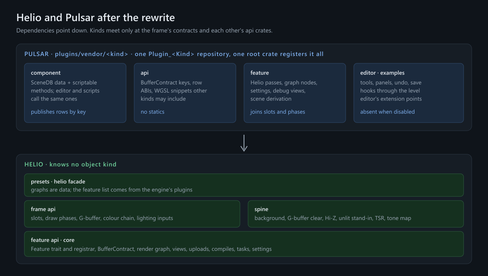

Helio used to know about everything it drew. Meshes, lights, materials, the sky, voxel terrain, water, foliage, decals and portals each had code inside the renderer, and most of them also had a SceneDB component there. None of that is in Helio now. Every object kind is a Pulsar plugin with its own repository. The plugin owns its data, its rendering, its file formats and its editor UI, and Helio is the frame those plugins draw into.

This post covers what the rewrite changed and why, in the order the pieces depend on each other. The first half is the rewrite inside the two repositories, from November 1 to 7. The second half is what came after: the repository split, the plugin kernel, Pulsar's own kernel, engine-owned renderers, views and portals.



## 1. Where the code was on October 31

The plan started from measurements, taken against both repos' main branches.

| Fact | October 31 |
|---|---|
| Helio workspace crates | 70, of which 54 were pass crates |
| Pass code | 177k lines of Rust and 47k of WGSL in one flat layer |
| SceneDB components defined in the renderer | 31 `#[derive(SceneStore)]` structs in 14 pass crates |
| Graph builder functions | 27, one per combination of features |
| `engine_backend` reaching into passes | downcasts into TSR, fog, post volumes, water and the voxel chunk pass |
| `helio-component` | 32k lines in the Helio repo that only built inside Pulsar's workspace |

One number made the case. In October, 161 of 408 voxel commits (40%) also changed crates outside the voxel code, and 36 changed four or more. A terrain change routinely touched the default graphs, the examples, `helio-component`, `helio-core` and the shadow, foliage, GI and fog passes.

The causes were structural. A pass was the only unit Helio had, but the real units were systems: GI, shadows, virtual geometry, water and voxels are each several passes plus glue plus settings plus a component. Dependency direction was not enforced, so passes imported passes for their types. Components lived in the renderer, so every culler and shadow pass imported the G-buffer pass to get the mesh component. Graphs were code. That is where the 27 builders came from.

## 2. The rules

Four rules emerged out of that diagnosis, and the rewrite applied them to every kind.

- Every object kind is a Pulsar plugin. The plugin owns its SceneDB component, the Helio feature that renders it, its scene derivation, its file formats and its editor UI.
- Component methods are the API. The editor calls the same scriptable methods a script would. No renderer setters for one kind, no mailbox messages, no reaching into a pass by type.
- Helio knows no object kind. It has no API for meshes, lights, materials, voxels, water, sky, fog or any other kind. A feature's passes read only what components publish.
- One owner per concept. Materials, lights, the sun, wind, water, shadows and GI each have exactly one owning plugin. Other kinds use the owner's api crate or WGSL snippet and never keep a private copy. A kind adds only its own addressing: UVs for meshes, triplanar and per-voxel ids for voxels.

## 3. The layers

Helio is now a stack where dependencies point down only.

- Core (`helio-core`): the render graph, scheduling, resources, views, uploads, off-frame pipeline compiles, shaders, GPU timestamps and the `BufferContract` type.
- Feature API (`helio-feature-api`): the `Feature` trait and the registrar a feature registers its nodes, settings, debug views and contracts through.
- Frame API (`helio-frame-api`): the contracts every kind meets at. Slots, draw phases, the G-buffer layout, the scene colour chain, coordinate spaces, and lighting inputs with stand-ins.
- Spine (`helio-spine`): the few passes no kind owns. A background clear, a G-buffer clear of last resort, the Hi-Z pyramid, an unlit stand-in for when no lights plugin is installed, TSR and the tone map.
- Presets and the facade: graphs are data, built from whatever features the engine registers.
- Two leaf crates serve every layer. `helio-tasks` runs Helio's threads and jobs on the host's task system, and `helio-settings` describes every setting a host can change, once.

Each plugin under `plugins/vendor/<kind>/` in Pulsar has the same crates: `component`, `api`, `feature`, `editor`, usually `examples`, and a root crate at the plugin's directory. A plugin depends on Helio core and on other plugins' `api` crates. It never depends on another plugin's feature or component.

## 4. Features, slots and draw phases

A feature is the unit a plugin adds to Helio. The trait is small on purpose:

```rust
pub trait Feature: Send + Sync + 'static {
    /// Stable id, used in diagnostics and by engines to name the feature.
    fn id(&self) -> &'static str;

    /// Registers what the feature contributes. Called once per registry.
    fn register(&self, registrar: &mut FeatureRegistrar<'_>);
}
```

Through the registrar a feature adds node types, preparers and finishers, the buffer contracts its passes read, settings and debug views. The renderer and the graph compiler see only what was registered.

Placement comes from the frame. A feature registers its nodes at a slot and the preset puts them there without naming the feature. There are nine slots, from `Prepare` (per-frame tables, an object kind's batches) through `Visibility`, `Geometry`, `LightingInputs`, `Lighting`, `Media`, `Resolved` and `Display` to `Output`. Drawing goes through draw phases: `ShadowCasters`, `DepthPrepass`, `GBuffer`, `Forward`, `Transparent` and `Overlay`. A phase is a place where every kind with something to draw there draws, into attachments the frame owns. Meshes, voxels and foliage all register G-buffer drawers. Decals draw after them. Billboards and light sprites draw in `Overlay`. The spine runs the phases and draws nothing itself.

Lighting reads inputs with generic names. Indirect diffuse, indirect specular, sun visibility, transmission, the sky and the light list are contracts. The lighting model never reads water, portals or reflection captures by name. A missing owner means a stand-in through the contract. Remove the lights plugin and the frame draws unlit albedo plus emissive.

## 5. Buffer contracts

The seam between a component and a feature is a buffer contract: a key plus a row layout. The consumer owns the layout, because the shader reads it. Foliage's wind is a typical one, declared in the foliage `api` crate:

```rust
#[derive(bytemuck::Pod, bytemuck::Zeroable, Clone, Copy, Debug, PartialEq)]
#[repr(C)]
pub struct FoliageWindRow {
    pub direction_speed: [f32; 4],
    pub gust: [f32; 4],
    pub time_prev_time: [f32; 2],
    pub _pad: [f32; 2],
}

/// The buffer the renderer reads [`FoliageWindRow`]s from. Engines produce it
/// (a SceneDB component stored under this key, or a scene derivation).
pub const FOLIAGE_WIND: helio_core::BufferContract<FoliageWindRow> =
    helio_core::BufferContract::new("foliage_wind");
```

The authored `WindComponent` lives in the plugin's `component` crate with its editor properties and methods. SceneDB mirrors its rows to the GPU under the contract's key, and the feature binds that key. Layout tests on both sides keep the Rust row and the WGSL struct identical. One pitfall showed up early: SceneDB accepts any `Send + Sync` value as a component, so inserting a bare row compiles fine and never reaches the GPU. Generating the component builders from the row removed that class of bug.

Helio still binds those keys through SceneDB's buffer projection. It defines no component of its own outside its test host. The test host writes contract rows by key for Helio's own examples and tests.

## 6. Checks that keep the rules true

Each rule has a check that runs in CI or as a test.

The layer gate (`just arch`) checks `cargo metadata` against `architecture/layers.toml`. Its violation list only shrinks. It held 19 entries at the start of the rewrite and holds none now. Since the split it also reads every identifier and key-like string in Helio's crates outside the test host, and fails on an object kind's name. That list held 46 names when the check was added and holds none now. Pulsar runs the same checker over its own kernel (section 10).

`one_owner` compares every shader's WGSL declarations, by name and by field layout, against every owner's snippets, and compares Rust string literals used as resource names against every owner's key constants. A copied struct or a hand-typed key fails the test. Its exception list is also shrink-only, and a stale exception fails too. The last copy it caught before the split was TSR's reactive-mask key, spelled out in three places after a merge. That key now lives in the frame API. The exception list is empty.

Absent plugins are tested. A project lists its plugins in `Pulsar.toml`, and each plugin has a descriptor:

```toml
id = "pulsar.post"
name = "Post-Process Volumes"
enabled_by_default = true
provides = [
  { id = "pulsar.post.rows", kind = "buffer", members = ["post_process_volumes", "camera_postprocess"] },
]
# Optional: volumes blend the lens's overrides; without the lens nothing reads them.
requires = [
  { id = "pulsar.lens.api", optional = true },
]
root = "post_plugin"
```

Every registration a plugin makes carries its origin, and every registry iterates only enabled origins. A disabled plugin's kind is absent: no component classes, no feature, no editor tools, no menu entries. This one started from a bug report. With the voxel plugin "uninstalled", voxels still rendered, because the engine linked every plugin unconditionally.

Pass-list snapshots compare the full pass list of every preset across five configurations. Each phase had to reproduce the previous phase's lists, or explain every difference.

## 7. The editor became a shell

`ui_level_editor` named object kinds in dozens of files. The sculpt tool, the terrain panel and the light editor lived there. Now it names no plugin. Plugins' editor crates register tool modes, create-menu entries, World Settings sections, save hooks, editor data, undo entries, overlays and AI-assistant tool namespaces through `ui_level_editor::extend`. The kind's component crates appear in the level editor's manifest only as dev-dependencies, for tests.

The shader editor got the same treatment. It had its own graph compiler and preview shaders, and both are gone. The material graph editor is now the materials plugin's editor. It compiles through the materials plugin's one compiler and previews with the plugin's shared preview program. The asset viewer uses the same program, so the editor can no longer drift from what the engine renders.

## 8. Every plugin is a repository

On November 7 the 16 kind plugins left Pulsar's tree for their own public repositories, `Plugin_<Kind>`, vendored back as submodules at the same paths. Their history came with them. `git subtree split` walked all 7254 Pulsar commits for each kind, with grafts that cut the commits from before the plugin directories existed, and each split tree was checked equal to Pulsar's tree at the split commit.

Each repository has a README with its crates table, an `AGENTS.md` that points to Helio's architecture skill, and its own CI. The CI checks the plugin inside a Pulsar checkout, on Pulsar's branch of the same name when one exists. Plugins added since then were created the same way: Character, DefaultPipelines and Bake. Each repository is listed in the public plugins registry, Far-Beyond-Pulsar/Plugins, which now has 34 entries.

A change that spans repositories lands dependency first. The plugin PRs merge, Pulsar re-pins every submodule to the merge commits on their main branches, and Pulsar's PR merges last. `scripts/submodule-pins.sh check --strict` fails while any pin is off its repository's default branch.

## 9. One root crate per plugin

After the split, a plugin's registrations needed one home. Before, any of a plugin's crates could submit a registration. Now each plugin has one root crate, the package at its directory (`water_plugin`, `post_plugin`), and only the root registers. The other crates hold code. Water's root is typical:

```rust
pulsar_plugins::installed!("pulsar-plugin.toml", build);

pub use water_component;
#[cfg(feature = "editor")]
pub use water_editor;

pub mod runtime;

#[cfg(feature = "editor")]
pub mod editor;

/// Everything the plugin registers (runtime always, editor with the `editor`
/// feature), through the builder the kernel hands the plugin's root.
pub fn build(p: &mut pulsar_plugins::PluginBuilder) {
    runtime::build(p);
    #[cfg(feature = "editor")]
    editor::build(p);
}
```

A game links the root without its `editor` feature and the editor links it with. `cargo tree -p pulsar_game -i gpui-ce` finds no `gpui-ce`, so a game build carries no editor UI.

Descriptors gained `provides` and `requires`, by contract id instead of by plugin name. The kernel resolves them at load time into the enabled set and a list of problems, each naming its consumer, contract and provider. Disabling the meshes plugin, for example, logs that the asset viewer needs `pulsar.meshes.api` and disables it with a reason. A replacement plugin provides the same ids, and two enabled providers of one contract are a named conflict.

`plugin_manager::catalog::CatalogSnapshot` is the one owner of what the plugins contribute, and the Extensions viewer is a view of it. Every buffer a feature reads is linked to the plugin that provides it or to the frame. Component classes declare their requirements in a `ClassSpec`, and required classes attach as nested component instances.

## 10. Pulsar's kernel

The rule Helio follows also applies to Pulsar's core and editor: no kind, subsystem or tool named in the kernel. Helio's layer checker was generalized and run over Pulsar's `architecture/layers.toml`, so both repositories use one implementation. Pulsar's baseline was 56 dependency violations and 132 places where kernel code named a kind. Both lists are shrink-only, and they now hold 2 and 21 entries.

Moving physics was most of the work. `engine_backend`'s physics feature turned out to be dead: a Rapier thread stepping a test ball, with a query service nothing fed. It was deleted, and physics lives wholly in Plugin_Physics. Input reaches the game session through a registered hook instead of a direct call.

Traits got their own kernel crate, `pulsar_traits`, with one trait index, conformance checks, roles and one dispatcher for Blueprint and native implementations. The plugin folders, designed by Tristan, let a plugin serve files at `plugins/<id>/` from any source, with writes allowed only to the owner. `std::fs` and the disk-querying `Path` methods are disallowed in the whole workspace through clippy, so project files go through the virtual file system. The allow list for the exceptions is shrink-only and holds 58 lines.

## 11. The engine owns the renderers

A renderer used to be something any panel could build. Following a design from Tristan, the engine now owns every Helio runtime through one `render_runtimes` service, with one scheduler and one device. Plugins and panels get handles and output buffers. A handle pauses, stops or resumes its renderer and sets when it draws: always, only while visible, or on demand. The Tasks window lists the renderers.

The shipped pipelines moved into a plugin too, `pulsar.default_pipelines`. Its `.rendergraph` files are generated from Helio's presets, so a third-party plugin's passes join the shipped pipelines where its feature placed them. A project can save a copy and edit it in the render graph editor.

This phase found the cause of a long-standing black editor viewport on voxel scenes:

- Cause: TSR wrote its transparency coverage into the output alpha, and the sharpen pass and the tone map forwarded it.
- Symptom: every frame had alpha near 0. The editor composites its viewport by alpha, so it showed the UI background while the runtime produced 35 frames a second. A game's opaque swapchain and the RGB-only parity tests never saw it.
- Fix: TSR's output alpha is 1 and coverage stays in its history. The rule is written in `helio_frame_api::color`: the colour chain's alpha is the scene's coverage only. `every_shipped_pipeline_draws_an_opaque_frame` checks every shipped file with and without TSR.

## 12. Frame owners

The next phase gave the frame's remaining shared pieces their owners.

Pipeline compiles left the frame. `helio_core::compile::Compiling<T>` runs a compile as a job on the host's task system, and `ready()` never waits. The voxel world draws once its pipelines are ready, where before one compile could hold the render thread for over two minutes under load. Helio's threads became services and jobs through `helio-tasks`, so Pulsar's raw-thread ratchet covers them.

Optional inputs became explicit. `ResourceBuilder::read_optional` declares an input whose producer may be absent. TSR reads the reactive mask that way, which fixed a render-thread panic in projects without the meshes plugin, the mask's only creator.

The sky's frame data split into a frame-owned `SkyFrame` and the sky plugin's `SkyLayers`. Baked lighting became its own plugin, `pulsar.bake`, with the Nebula baker vendored inside it. The G-buffer was already at WebGPU's limit of 8 colour targets, so the old lightmap-UV channel became a general `SURFACE` channel. A feature requests one payload per graph through it. Lightmaps now hold indirect light only and refine `INDIRECT_DIFFUSE` in place. That phase also fixed a correctness bug: every mesh's lightmap shared the whole atlas, so separate floors baked into the same texels. Regions are now assigned before the bake.

With that, Helio's list of object-kind names reached zero.

## 13. Views and portals

Water's reflection and the portals each had a private copy of the mesh G-buffer program, so foliage, decals and virtual geometry appeared in neither. The fix took two attempts.

A view is a second image of the scene: its own camera, targets and lighting. `ViewContext::render_view` renders one, composed from the preset's own members (`Preset::view_nodes`), with a budget in the settings. Water's planar reflection is a real view, because a mirror is not a rigid transform and water samples the result as a texture. The capture renders at half resolution by default, and only while a water surface is in the frustum.

The first attempt also made portals views, with a virtual camera behind each opening. That design was rejected on review and replaced in the same week. Pulsar's portals are coordinate spaces: sublevels placed by a rigid transform and clipped by the opening's plane. Content seen through a portal is just more draws into the main G-buffer, in the space its chain of openings maps it to. A chain row holds the composed transform for this frame and the last:

```rust
/// One live chain on the GPU (the snippet's `GpuPortalChain`, 160 bytes).
#[repr(C)]
#[derive(Clone, Copy, Debug, Default, PartialEq, bytemuck::Pod, bytemuck::Zeroable)]
pub struct GpuPortalChain {
    pub content_to_drawn: [f32; 16],
    pub prev_content_to_drawn: [f32; 16],
    pub first_stage: u32,
    pub stage_count: u32,
    pub first_hole: u32,
    pub hole_count: u32,
    /// The outermost opening's id ([`PORTAL_MASK`] holds `opening + 1`).
    pub opening: u32,
    /// The chain's remap: its index in [`PORTAL_CHAINS`] and in
    /// `helio_frame_api::lighting::VIEW_REMAPS`.
    pub remap: u32,
    pub _pad: [u32; 2],
}
```

Chains are composed on the CPU in f64 around the frame origin, up to a depth of 3 by default. A mask pass stamps the outer openings and clears the depth behind them. Each drawer then emits one draw per pair of instance and chain, with its own program and the portals plugin's shared WGSL snippet. Meshes draw a second time through the same `gbuffer.wgsl`, and foliage adds its own occurrence draws. Each pixel drawn through a chain carries the chain's remap, so lighting and decals map it back to its own world.

Virtual geometry needed more, because it resolves into the G-buffer before the mask runs. Its passes now take a run descriptor, and a second run after the mask draws only the VG instances seen through live chains, already mapped into drawn space.

| Cost of one linked portal pair | GPU time |
|---|---|
| Portals as views (the first attempt) | 1.49 to 1.66 ms |
| Portals as coordinate spaces | about 0.22 ms |

Through one portal, virtual geometry covers 4791 depth texels against 4792 for classic meshes.

## 14. Housekeeping

Two loose ends from the split broke builds outside our machines.

- Cause: Helio took the `profiling` crate as a git dependency on an old Pulsar-Native commit, and that commit still listed a private submodule.
- Symptom: a generated game failed dependency resolution for anyone without access to that repository, CI included.
- Fix: `profiling` now lives in the public Pulsar-Profiling repository, which Pulsar vendors as a submodule and Helio pins by revision. `just check-pulsar-native-git-deps` fails if a manifest takes Pulsar-Native as a git source again. A generated game now builds from an empty cargo cache with no credentials.

The workspace also silenced every rustc warning with `-A warnings`, which hid dead code from the rule that replaced code gets deleted. On Windows and Linux the flag never applied, since a `[target]` rustflags entry overrides `[build]` rustflags, so it hid warnings on macOS only. Removing it showed 1067 warning sites. They are at 0 now, mostly by deleting the dead code, and CI fails on new ones.

Helio's README now describes the renderer as it is, and its Rust blocks run as doctests.

## 15. How it landed

The rewrite ran as phases p0 to p26, each on a branch with the same name in every repository it touched (`rewrite/p5-features`, `rewrite/p25b-portal-spaces`, and so on). Up to p17 each phase was one PR per repo, stacked on the phase below it. From p18 on, a phase was one PR in Pulsar, one in Helio and one in each plugin it touched.

Groundwork came first: guard rails and the layer gate, buffer contracts, the feature API and the spine. Voxel moved next, as the pilot, since its coupling was the worst measured and its 43k lines of Rust and 10k of WGSL had shipped as "a pass". The leaf kinds followed (decals, particles, sprites, portals, splines, lens), then the media kinds (fog, post, water, foliage), then GI and sky, meshes, lights and materials. After those came the one-owner audit, absent plugins, the editor extension points, the mesh components and a cleanup phase. The second half (p18 to p26) is sections 8 to 14.

Three things were checked at every phase. The pass lists had to match. A `voxel_craft` build was A/B tested against the previous phase's binary, kept on disk so no base commit had to be rebuilt. The render acceptance suite had to pass or the failure had to be explained. It has grown from 27 tests to 33, and all of them pass.

Moving code surfaced real bugs, some of them old:

- The depth and normal debug views compared mode numbers 40 and 41 in the shader while Rust sent 42 and 43. The test passed only on frame noise.
- Point and spot light shadows never darkened anything. A constant depth bias in NDC was larger than the depth separation at tens of metres. Local lights now bias in world space.
- Every water row was an ocean. Lakes and pools now clip their surface, fog, light shafts and caustics to their volume.
- The device-loss watcher kept every `wgpu::Device` alive forever, so dropped renderers never freed their VRAM. That was the cause of a whole-suite out-of-memory failure.
- On Linux the plugin manager loaded plugins through `/proc/self/fd/N` and closed the descriptor afterwards. The next plugin opened under the same number, and `dlopen` returned the first library by name, so every plugin after the first was the first.
- Packaged games skipped a record migration once it moved into the meshes plugin, because the packager did not link installed plugins.
- D3D12 rejected the status screen's text shader, which ended a non-void fragment function in `discard`. The editor's first renderer build panicked on that backend.
- The editor's loading screen opened the file index before the project was mounted, and verbatim `\\?\` roots on Windows never matched.
- The first virtual geometry run through portals rebuilt an instance tree every frame, at 4 to 7 ms. The run now seeds its cull with the mapped instances directly and builds no tree. Classic portal draws also drew VG meshes a second time.

## 16. The numbers afterwards

| | October 31 | November 7 | November 17 |
|---|---|---|---|
| Helio crates | 70 (54 passes) | 17 core crates and 11 small passes | 29, of which 11 are small passes |
| SceneDB components in Helio (outside its test host) | 31 | 0 | 0 |
| Object-kind names in Helio (outside its test host) | not checked | not checked | 0 (46 when checked first) |
| Graph builder functions | 27 | 0, presets are data | 0 |
| Recorded Helio layer violations | 19 | 0 | 0 |
| Pulsar kernel layer violations | not checked | not checked | 2 (56 when checked first) |
| Kind names in Pulsar's kernel | not checked | not checked | 21 (132 when checked first) |
| Plugins in their own repository | 0 | 0 | 27 vendored, 34 in the registry |
| rustc warnings in first-party crates | hidden | hidden | 0 |
| Render acceptance tests | | 27 | 33 |

Helio's diff over the first week is 12k lines added and 375k removed, and Pulsar's is 423k added and 17k removed. Most of that is the same code changing address. Helio took 135 commits and Pulsar 195 between November 1 and 7. Since November 8, Helio has 83 more commits (14k lines added, 20k removed) and Pulsar 229 (96k added, 55k removed, not counting the plugin repositories).

## 17. What comes next

These items are open, each tracked as an issue or a design question:

- Lights and shadows through portals. Content seen through a portal is lit by its own world's lights and casts no shadows through the opening.
- Voxel terrain does not draw in secondary views, such as the water reflection.
- The final structure of virtual geometry and of the animation runtime. Both moved structurally and kept their open problems. The direct VG path still ignores coordinate spaces.
- Pulsar's kernel still names kinds in 21 places, and five plugins still live in Pulsar's tree.
- Bundling first-party plugins into a few libraries. A render plugin in its own DLL would get its own copy of Helio's process-wide caches, so Helio needs a runtime attach first.
- The clippy lane, which still fails on lints older than the rewrite.

The next rendering work builds on the frame's contracts: one ray-traced scene owned by the frame, GI from hardware ray tracing, a surface cache for ray hits, ReSTIR-class direct lighting, ray-traced reflections and one reconstruction service.
